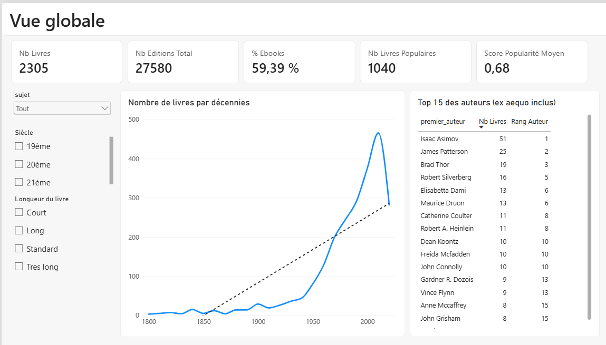
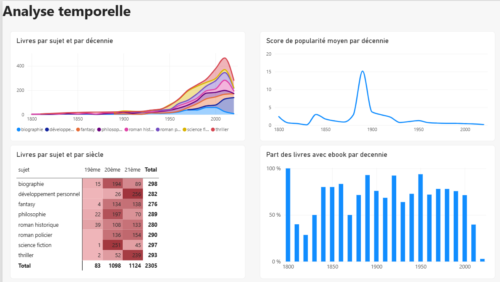
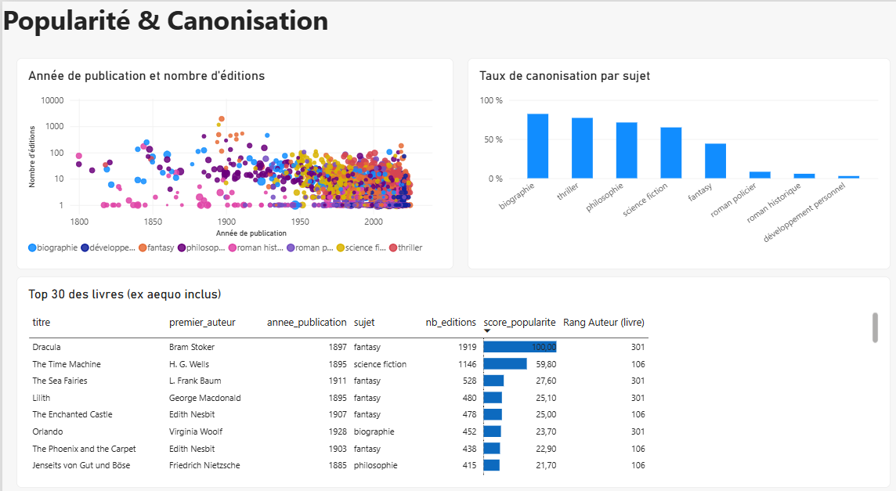
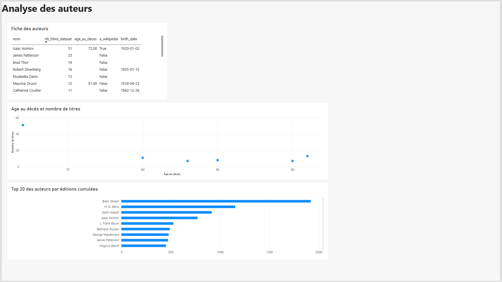
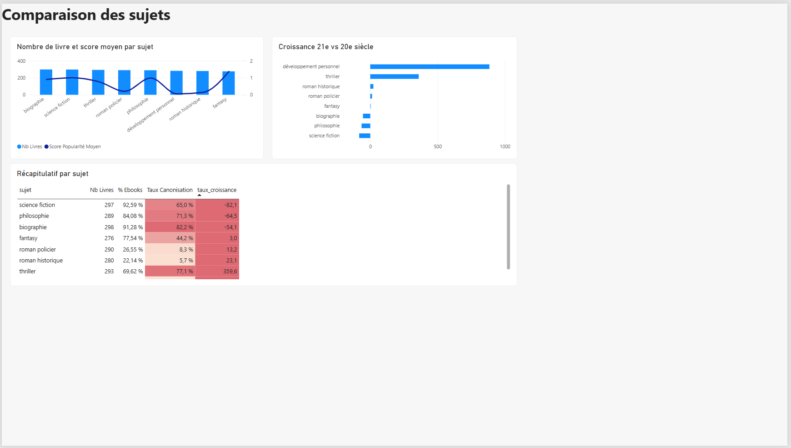
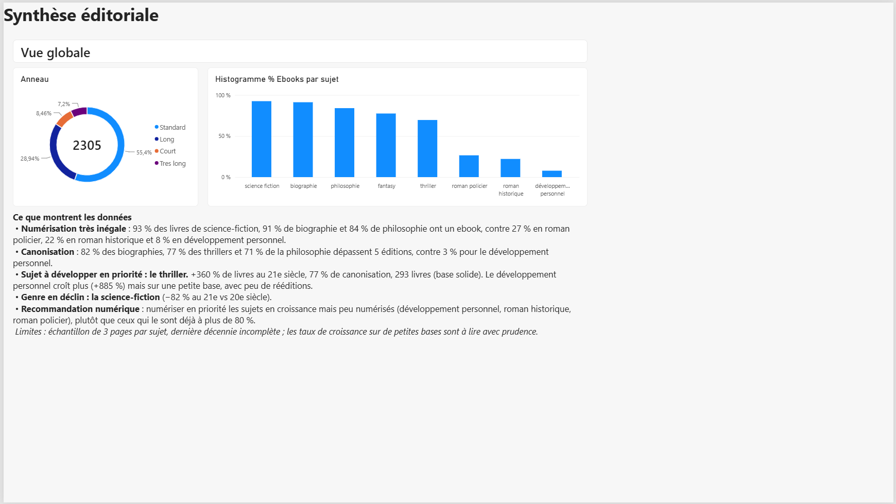

# Analyse du marché du livre : Open Library → Python → Power BI

Projet d'analyse de données de bout en bout : collecte via une API publique, nettoyage et analyses avec Python (pandas), puis dashboard Power BI de 6 pages.

> Projet de ma formation B2 IA & Data (Ynov Campus Lyon), repris et finalisé. J'ai cherché à comprendre chaque étape, et je documente aussi mes limites.

## Contexte
Scénario : un groupe d'édition envisage de racheter des librairies indépendantes. Il souhaite comprendre comment le marché du livre est structuré et quels genres développer en priorité. Pour cela, il fait appel à un data analyst.

## Ce que j'ai fait
- **Collecte** : API Open Library, 8 sujets, 24 appels (3 pages par sujet), gestion des erreurs.
- **Python / pandas** : nettoyage, variables calculées (décennie, siècle, popularité…), tableaux croisés, taux de croissance.
- **Power BI** : modèle en étoile, 10 mesures DAX, 6 pages.

**Chiffres clés :** 2 305 livres · 8 sujets · 59 % de livres numérisés · 45 % de livres « canonisés » (au moins 5 éditions).

## Aperçu du dashboard
| | |
|---|---|
|  |  |
|  |  |
|  |  |

Export PDF complet : [`powerbi/TP-Livres.pdf`](powerbi/TP-Livres.pdf)

## Principaux résultats
- **La part d'ebooks ne suit pas la révolution numérique** : élevée de 1950 à 2000 (≈ 70-90 %), elle chute en 2010 et 2020. L'indicateur reflète sans doute la numérisation d'anciens livres, pas la publication en ebook.
- **Numérisation inégale** : plus de 90 % en science-fiction et biographie, 8 % en développement personnel.
- **Sujet prioritaire : le thriller** (+360 % de livres au 21e siècle par rapport au 20e, 77 % de canonisation). Le développement personnel croît plus (+885 %) mais avec très peu de rééditions.
- **Genre en déclin : la science-fiction** (−82 % de livres au 21e siècle par rapport au 20e).
- **Pas de corrélation fiable entre l'âge au décès et le nombre de titres** : seuls 6 auteurs ont une date de décès.

## Limites et choix
- **Ex aequo** : Top 15 auteurs = 17 lignes, Top 30 livres = 43, car Power BI garde tous les ex aequo.
- **`Rang Auteur`** : dans le Top 30 (une ligne par livre), la mesure demandée dans l'énoncé renvoyait 1 partout (le filtre sur le titre isole un livre). J'ai créé `Rang Auteur (livre)`, qui retire ce filtre avec `ALLEXCEPT`.
- **Les ebooks** : `has_ebook` veut sans doute dire « il existe une copie numérisée », pas « publié en ebook » (hypothèse).

## Difficultés
- **API instable** : erreurs serveur, gérées par `try/except` et nouvelles tentatives.
- **Power BI lisait des nombres comme du texte** (impossible de faire une moyenne) : corrigé dans Power Query avec les paramètres régionaux « Anglais (États-Unis) ».

## IA et Git
J'ai utilisé l'IA de manière encadrée : elle m'a expliqué les points bloquants (relations, DAX, types), ce qui m'a permis de comprendre les étapes et leurs impacts au lieu de réaliser un projet sans en comprendre les enjeux. J'ai fait des **commits fréquents avec un titre clair** pour pouvoir revenir à une version précédente.

## Structure et reproduction
```
├── TP_Livre.ipynb       # collecte, nettoyage, analyses
├── data/                # livres_clean.csv, sujets.csv, decennies.csv, auteurs_top20.csv, pivot_siecles.csv
├── powerbi/             # TP-Livres.pbix (Power BI Desktop, Windows) + TP-Livres.pdf
├── images/              # captures du dashboard
└── README.md
```
1. `pip install pandas requests jupyter`, puis lancer `TP_Livre.ipynb` (la collecte peut prendre quelques minutes).
2. Le fichier `powerbi/TP-Livres.pbix` se télécharge depuis GitHub (il ne s'affiche pas dans le navigateur) et s'ouvre avec **Power BI Desktop** (gratuit, Windows uniquement). Sans lui, les captures et le PDF montrent le résultat.

**Auteur :** SELMAN Marjane, B2 IA & Data, Ynov Campus Lyon.
